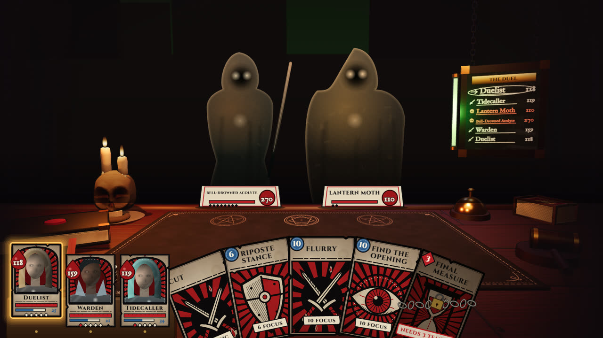
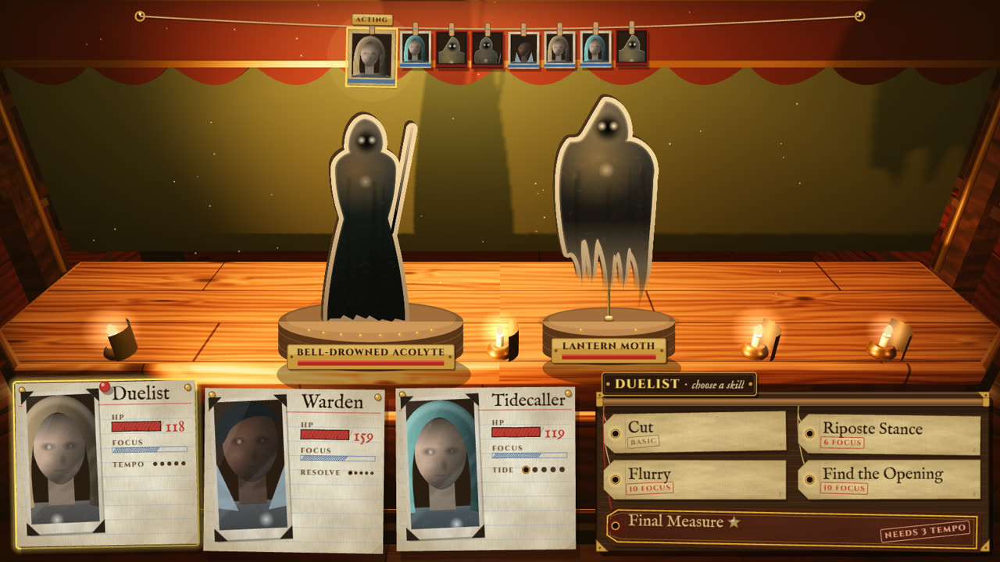
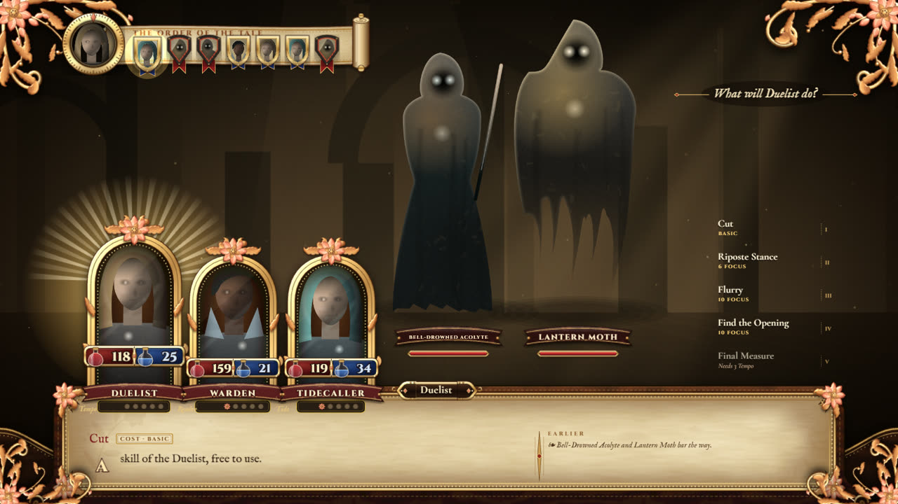
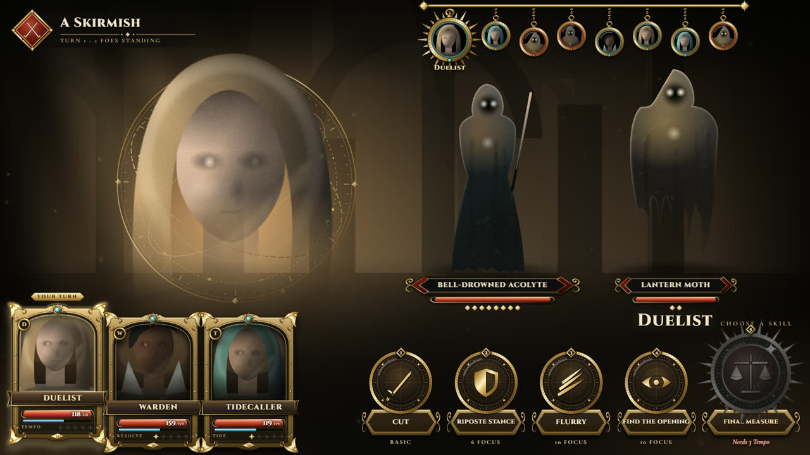
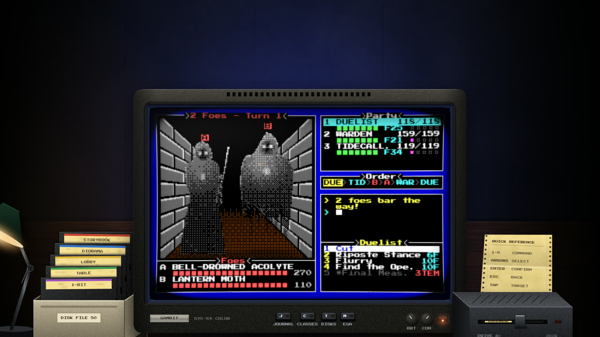
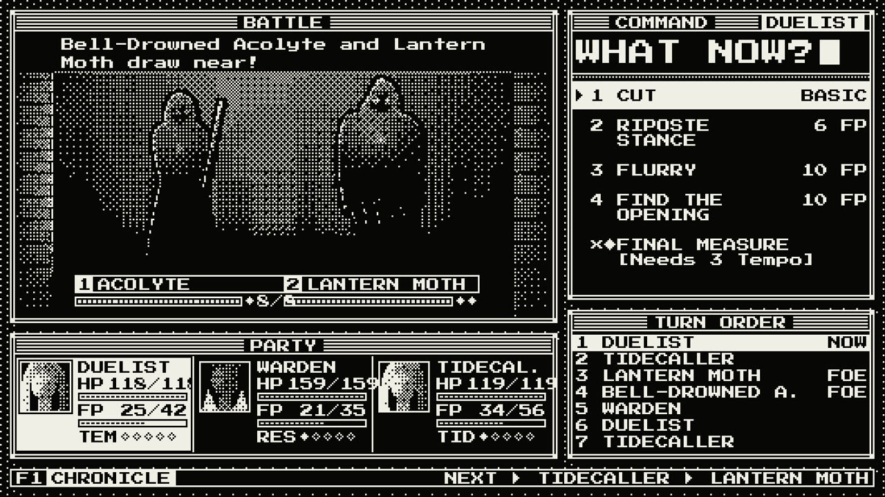
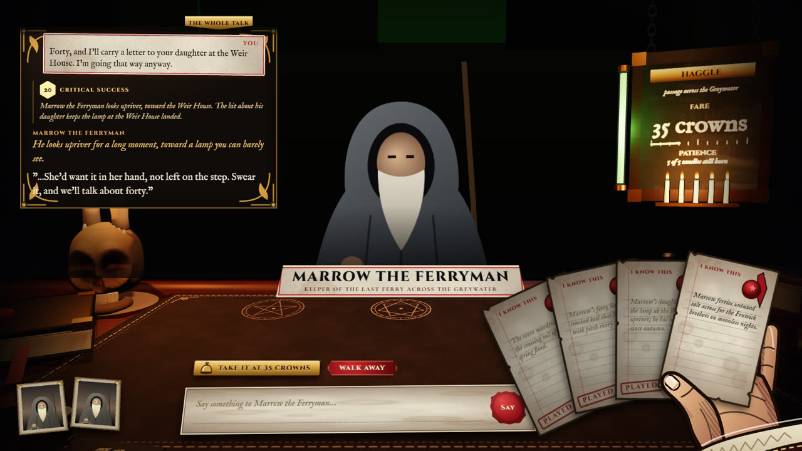
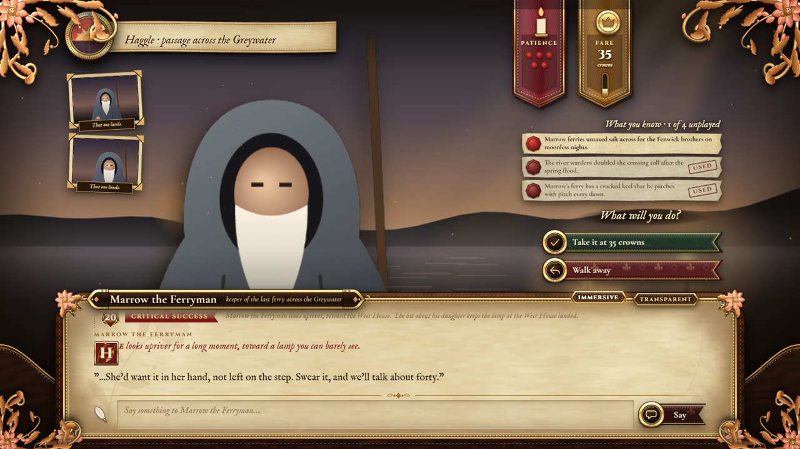
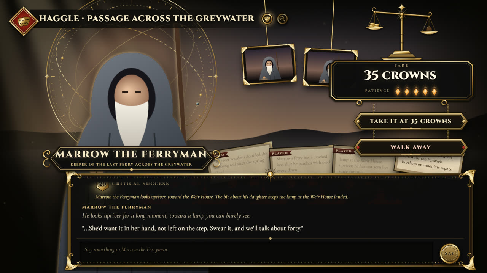

<div align="center">

# Gambit

**An RPG under your roleplay.**
Deterministic turn-based combat, words that move the dice, fusable classes, and generated art that moves.
A [Lumiverse](https://lumiverse.chat) extension.

[](https://github.com/japolino/gambit/actions/workflows/ci.yml)
[](spindle.json)
[](https://lumiverse.chat)
[](https://github.com/japolino/gambit/commits/master)
<br>
[](https://www.typescriptlang.org)
[](https://bun.sh)
[](https://pixijs.com)
[](https://threejs.org)



</div>

## What it is

You roleplay in Lumiverse the way you always do; underneath sits a real game. Gambit plays **the card you have selected**: its characters are the people you bargain with, fight and travel beside, its lorebooks are the map, and your persona is your character sheet.

- **Models judge, code decides.** Models design skills, read your arguments and draw the world. Every number comes from seeded dice and formulas in code, so nothing a model says can save you from a bad roll or cheat you out of a good one.
- **Your words are a stat.** In a Parley (a talk, a haggle, a bluff) what you actually type is scored into a bounded dice modifier, and you see the roll.
- **Real fights.** A turn-based timeline engine with focus, class resources, statuses, signature skills and full-screen cut-ins.
- **Classes you shape.** Fuse two classes, or forge one from a sentence; every new signature skill gets its own illustrated cut-in.
- **Art that moves.** Portraits, figures, places and moments are generated per card and animated as puppets on the stage. The game never waits for art.
- **Six interfaces.** Each scene theme is its own game interface, down to how a fight and a talk look.

## Themes

Every theme carries its look through the scene, the battle and the Parley. Table and Diorama are real three.js rooms, and their fights and talks happen inside them.

| | |
|:-:|:-:|
| <br>**Diorama**: the fight on the shop counter | <br>**Storybook**: a battle told on the book's pages |
| <br>**Lobby**: brass cards and skill medallions | <br>**Command**: a crawler fight on the monitor |
| <br>**1-bit**: two colours, one grid | <br>**Table Parley**: facts in hand, patience as candles |
| <br>**Storybook Parley**: a visual-novel talk | <br>**Lobby Parley**: the deal on a brass balance |

*Screenshots use the preview's code-drawn stand-in art; in play, the art comes from your card.*

## Install

1. In Lumiverse, open the drawer → **Extensions** → **Add Extension**.
2. Paste `https://github.com/japolino/gambit` into **Install from Source** and click **Install**.
3. Review the requested permissions and turn the extension on. It needs Lumiverse 1.2.4 or later.
4. Open a chat and choose **Play with Gambit** in the Gambit drawer.

Gambit uses your Lumiverse connections for text and images.

## Development

Requires [Bun](https://bun.sh) 1.4.

```bash
bun install
bun run verify        # tests, typecheck and build
bun run preview       # standalone preview at http://localhost:4174 (no Lumiverse needed)
```

| Command | What it does |
| --- | --- |
| `bun test` | Engine, art pipeline and UI logic tests |
| `bun run typecheck` | `tsc --noEmit` |
| `bun run build` | Bundles `dist/backend.js` and `dist/frontend.js` |
| `bun run preview` | Scene, battle (`/`), Parley (`/parley`) and cut-in (`/cutin`) harnesses, rebuilt on every request |
| `bun run play` | Plays a battle in the terminal with no models and no art |
| `bun run balance` | Runs every encounter hundreds of times and reports the balance |
| `bun run fx:import` | Indexes the effect sheets and sounds in `assets/` (see [assets/README.md](assets/README.md)) |
| `bun scripts/deploy-local.ts <lumiverse dir>` | Copies a build into a local Lumiverse install |

### Layout

```text
src/
  engine/      rules: combat, Parley, dice, classes (pure, seeded, tested)
  backend/     the Spindle side: card reading, model calls, art queue, storage
  frontend/
    stage/     Pixi battle stage, cut-ins, effects, per-theme battle screens (stage/themes)
    parley/    the Parley view and per-theme Parley screens (parley/themes)
    scene/     the scene screen and its six themes, two of them three.js rooms
  shared/      protocol and types shared by both sides
assets/        effect sheets and sounds, played by slot
looks/         art-direction presets
docs/DESIGN.md the full design document
```

The design, the rules and the roadmap are in [docs/DESIGN.md](docs/DESIGN.md).

## Credits

- Effect animations by [ぴぽや (Pipoya)](https://pipoya.net/sozai/) and sound effects by [効果音ラボ (Sound Effect Lab)](https://soundeffect-lab.info/), used under their terms; see [assets/CREDITS.md](assets/CREDITS.md).
- Fonts: Cinzel, Cormorant Garamond, IM Fell English, Press Start 2P and VT323, under the SIL Open Font License ([licenses/](licenses)).
- Built on [PixiJS](https://pixijs.com) and [three.js](https://threejs.org).
